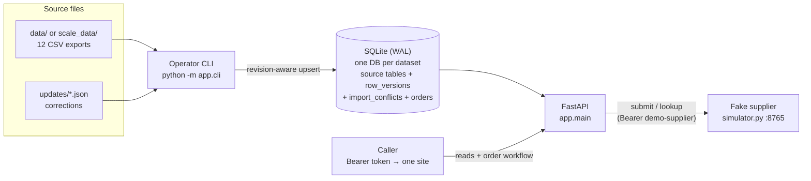

# Architecture

## Diagram

Components: an operator CLI owns all writes (imports and corrections); FastAPI serves reads and the order workflow; SQLite in WAL mode is the single store per dataset (`app_small.sqlite` for `data/`, a separate DB for `scale_data/` — never merged). The only external call is to the local fake supplier.

## Data model

Each CSV gets a **current-state table** keyed `(site_id, natural_id)`, storing every source column **verbatim as TEXT** plus lineage: `source_revision`, `content_hash` (sha256 of non-revision fields), `source_file`, `imported_at`. Two system tables complete the story:

- `row_versions` — superseded versions as JSON, so any answer can show what changed and when.
- `import_conflicts` — equal revision but different content is recorded, never silently applied.

One upsert path serves CSV imports and JSON corrections identically:
`rev > current` → audit old row, replace; `rev == current` + same hash → no-op (repeat-safe); `rev == current` + different hash → conflict recorded; `rev < current` → stale no-op (re-importing originals cannot reverse a correction).

**Why TEXT + Decimal:** quantities and money are never floated; arithmetic happens at the read boundary with `decimal.Decimal`, so answers are deterministic and the content hash is stable. One pragmatic cast: `SUM(CAST(quantity_sold AS INTEGER))` aggregates the 100k sales rows in SQL.

## Read APIs

Three site-scoped endpoints per ingredient: **purchases** (billed qty × the pack size captured on that invoice line — a later catalog change never rewrites history; spend is recorded line totals, never recomputed), **usage** (POS sales × recipe per-portion, choosing the recipe version by `effective_from`; an item sold with *no recipe at all* is reported as unknown in `gaps`, while a recipe that merely omits the ingredient is known zero), and **counts** (verbatim observations, no derived balance). Every response carries `answer`, `sources` (file, row id, revision), and `gaps` (e.g. "received" status is office-entered and does not prove stock arrived). Quantities group by source unit; no invented conversions.

**Auth:** seeded bearer tokens map to exactly one site. Cross-site requests return **404** (not 403) so callers cannot probe which sites exist. This is demo identity, not production auth.

## Order workflow

`DRAFT → APPROVED → (SUBMIT_PENDING) → SUBMITTED | REJECTED`

- Approval requires echoing the draft's exact `content_hash`; submit re-verifies it, so a human approved precisely what is sent.
- `client_reference` is fixed at draft creation and persisted — restarts and retries reuse it, and the supplier deduplicates on it.
- `SUBMIT_PENDING` is persisted **before** the HTTP call. If the connection drops after the supplier accepted (the `supplier-timeout` scenario), the order stays `SUBMIT_PENDING` with the error recorded; `reconcile` queries the supplier by reference and either confirms `SUBMITTED` or returns the order to `APPROVED` for a safe resubmit.

## Scale & measurement (see BENCH_RESULTS.json; machine noted inside)

100k-row import ≈ 0.9 s via a bulk fast path used only when a table is empty; re-imports take the full revision-aware path. The pack correction applies in ≈ 0.9 ms touching 2 rows (1 replace + 1 audit) — ~1,000× cheaper than a rebuild, with identical answers verified against a clean rebuild. A reader thread polling the affected query during the update never exceeded 0.5 ms (WAL). Explained improvement: the composite index `(site_id, pos_item_id, business_date)` on `pos_daily` turns the usage scan into an index search (shown via `EXPLAIN QUERY PLAN`).

## Limits / out of scope

Nested recipes, waste records, a full stock ledger or measured food-cost %, deletions, pagination, production auth, and any UI. The supplier models no prices or delivery; "accepted" ≠ received at the restaurant (surfaced in `gaps`). Single-writer SQLite is a deliberate fit for one operator CLI + many readers; a multi-writer deployment would move to Postgres with the same schema and upsert semantics.
